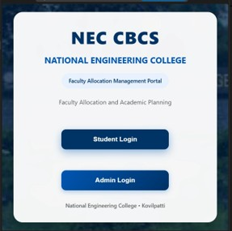
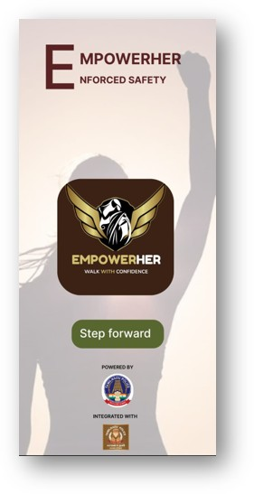

# ✨ The Digital Journey

<h2>Hello, World! I'm Harini C 👋</h2>

<i>“Dream in possibilities, think in logic, and create with code.”</i>

 

<b>Computer Science Engineering Student | Full Stack Developer | AI/ML Enthusiast</b>

 

 

  Passionate about building web applications and intelligent solutions.
  Exploring emerging technologies, solving challenging problems, and
  turning creative ideas into practical software.

## About Me

I am a Computer Science and Engineering student passionate about software engineering, full-stack development, and artificial intelligence. I enjoy exploring new technologies, solving complex problems, and developing applications that address real-world challenges.

- Pursuing B.E. in Computer Science and Engineering at National Engineering College.
- Experienced in building full-stack web applications using the MERN stack.
- Exploring Artificial Intelligence, Machine Learning, and Natural Language Processing.
- Gained practical industry exposure through internships in MERN Stack Development and Artificial Intelligence.
- Interested in Data Structures, Algorithms, and designing scalable software solutions.
- Global Nominee at NASA Space Apps Challenge and winner of multiple coding competitions.
---

## Technical Skills

<table>
<tr>
<td width="50%" valign="top">

### Programming Languages

</td>
<td width="50%" valign="top">

### Frontend Development

</td>
</tr>

<tr>
<td width="50%" valign="top">

### Backend & Database

</td>
<td width="50%" valign="top">

### Tools & Technologies

</td>
</tr>
</table>

## Featured Projects

<table>
<tr>
<td width="50%" align="center" valign="top">

### 1. Smart Campus Facility Booking System

**MERN Stack | NLP**

A campus facility reservation platform that enables students and faculty to check availability, book facilities, and manage reservations with AI chatbot assistance.

</td>
<td width="50%" align="center" valign="top">

### 2. Payroll Management System

**MERN Stack**

A payroll automation system for KR Mill that streamlines employee salary calculation, attendance management, leave tracking, and payslip generation.

</td>
</tr>

<tr>
<td width="50%" align="center" valign="top">

### 3. Choice Based Credit System (CBCS)

**MERN Stack**

An academic management platform that simplifies course selection, subject registration, faculty allocation, and credit management for students and administrators.

</td>
<td width="50%" align="center" valign="top">

### 4. Empower Her – Women's Safety App

**Figma | MERN Stack**

A women's safety application prototype designed around insights from Thoothukudi Police.

 

</td>
</tr>
</table>

## 🏆 Achievements

- 🥇 **First Prize** – CodeRewind
- 🥈 **Second Place** – Logic Ladder
- 💻 Participated in Infosys HackWithInfy L3
- 🚀 Participated in multiple hackathons

---

## 📊 GitHub Statistics

  
  

---

## 🤝 Connect With Me

  
  

---

  💙 Learning | Building | Improving

